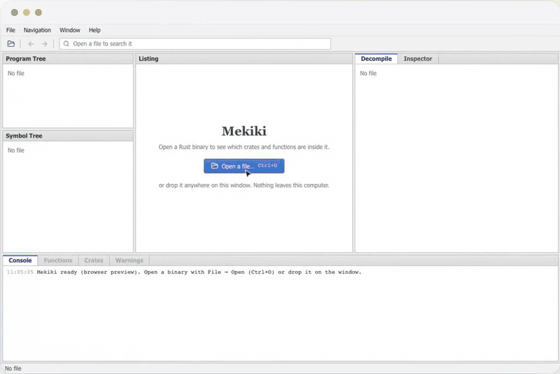

<p align="center">
  
</p>

<h1 align="center">Mekiki（目利き）</h1>

<p align="center">
  <b>Rust のバイナリの中身が見えるアプリ。</b><br>
  macOS・Linux・Windows で動く無料のデスクトップアプリです。Rust のプログラムを開くと、入っている crate・関数・コードが見えます。
</p>

<p align="center">
  <a href="https://rustsecjp.github.io/mekiki/"><b>サイト</b></a> ·
  <a href="https://github.com/RustSecJP/mekiki/releases/latest"><b>ダウンロード</b></a> ·
  <a href="README.md">English</a>
</p>

<p align="center">
  
</p>

## できること

Rust のプログラムは、ソースのない一つの大きなバイナリとして配られます。Mekiki はそのファイルを開いて、中に何が入っているかを見せます。

- **入っている crate と、その版。** 関数を crate ごと（`serde_json 1.0.x`、`tokio`、標準ライブラリ、持ち主不明）に分けて並べます。
- **どの関数のコードも。** 逆アセンブル（機械語を命令に戻したもの）と、逆コンパイル（読みやすいコードに戻したもの）を並べて表示し、panic の場所や文字列を注記します。
- **ファイルそのものの情報。** セクション、セグメント、インポート、ビルドした rustc の commit、配置のおかしなところ。

Linux の ELF と Windows の PE（`.exe` / `.dll`）を、x86-64 と x86 で読めます。解析はすべてこのパソコンの中で行い、ファイルをどこにも送りません。

## ダウンロード

| OS | ファイル |
| --- | --- |
| macOS（Apple シリコン・Intel） | [Mekiki-macos-universal.dmg](https://github.com/RustSecJP/mekiki/releases/latest/download/Mekiki-macos-universal.dmg) |
| Linux（どのディストリビューションでも） | [Mekiki-linux-x86_64.AppImage](https://github.com/RustSecJP/mekiki/releases/latest/download/Mekiki-linux-x86_64.AppImage) |
| Linux（Debian・Ubuntu） | [Mekiki-linux-amd64.deb](https://github.com/RustSecJP/mekiki/releases/latest/download/Mekiki-linux-amd64.deb) |
| Windows（x64） | [Mekiki-windows-x64-setup.exe](https://github.com/RustSecJP/mekiki/releases/latest/download/Mekiki-windows-x64-setup.exe) |

すべてのファイルと、確認用のハッシュ値（`SHA256SUMS`）は [リリースのページ](https://github.com/RustSecJP/mekiki/releases/latest) にあります。

### 入れ方

**macOS**: `.dmg` を開き、Mekiki をアプリケーションへドラッグします。Apple の証明書で署名していないので、初めてのときは、アプリケーションの Mekiki を右クリックして **開く** を選び、もう一度 **開く** を押します。「壊れている」と出たときは、ターミナルで一度だけ次を実行します。

```sh
xattr -dr com.apple.quarantine /Applications/Mekiki.app
```

**Linux（AppImage）**: 実行できるようにしてから起動します。

```sh
chmod +x Mekiki-linux-x86_64.AppImage
./Mekiki-linux-x86_64.AppImage
```

**Linux（.deb）**: `sudo apt install ./Mekiki-linux-amd64.deb` のあと、アプリの一覧から Mekiki を起動します。

**Windows**: インストーラーを実行します。SmartScreen が「発行元が不明」と出したら、**詳細情報** → **実行** を選びます。

あとは **File → Open**（`Ctrl+O`）か、ファイルを窓に落とすだけです。初めてなら **Help → Tutorial** が、Mekiki 自身の実行ファイルを練習用に開いて、使い方を案内します。

## こんなときに

- **サーバーで見覚えのないバイナリを見つけた。** 動かす前に Mekiki で開けば、どんな crate を使っているか（通信？暗号？プロセスの操作？）、どんな文字列や panic のメッセージを持っているか、`main` が何をしているかが分かります。
- **バイナリに本当に入っているものを確かめたい（サプライチェーン）。** SBOM に書かれた内容と、配るバイナリの中身が同じとは限りません。入っている crate とその版、ビルドした rustc の commit を、バイナリだけから確かめられます。
- **Rust 製のマルウェアを解析する。** Rust のマルウェアは、名前が長くて崩れていたり、標準ライブラリに大事なコードが埋もれたりして、汎用の道具では読みにくいものです。Mekiki は作者のコードを crate や `std` から分けて見せ、名前の消えたファイルでも、指紋のデータベースで関数に名前を付けられます。
- **Rust がどう機械語になるかを学ぶ。** 小さなプログラムを書いてビルドし、`Option` やイテレーターや `?` が何になるのかを、関数ごとに見られます。

## 主な機能

- **Symbol Tree**: 関数を、自分のプログラム・crate ごと（版つき）・標準ライブラリ・持ち主不明に分けて表示。
- **Listing**: コードをアドレス順に、逆アセンブル・関数の見出し・押せる参照つきで表示。ブラウザのように戻る・進む（`Alt+←` / `Alt+→`）。
- **Decompile**: 関数を読みやすいコード（Rust 風か C 風）に戻し、panic の場所と文字列の中身を横に注記。Ghidra の逆コンパイラを内蔵しているので、Java も Ghidra も要りません。
- **Inspector**: 選んだものの詳細。crate は crates.io と docs.rs へのリンクつき。
- **表**: Functions・Crates・Warnings。並べ替えと絞り込みができます。
- **どこへでも移動**: `G` でアドレス・関数・セクション・crate へ。
- **指紋（fingerprint）**: 名前の消えたバイナリの関数に名前を付けます。データベースを読み込むか、信頼できるファイルを自分のデータベースに足せます。
- **Windows のファイルも**: インポートした関数を、コードの中に名前で表示（`kernel32.dll!CreateFileW`）。

## すべて手元で動きます

Mekiki はファイルをどこにも送らず、外へ通信もしません。ファイルは読むだけで、実行はしません。逆コンパイラは別のプロセスで動くので、逆コンパイラが混乱するファイルでもアプリは落ちません。

## しくみ

Mekiki の中身は、このリポジトリにある Rust のライブラリ群 **unforge** です。unforge は、壊れた ELF や PE、わざと崩したファイルでもパニックせずに読み、関数を見つけ、コンパイラが残したパスやシンボルから各関数の crate を割り出し、iced-x86 で逆アセンブルします。逆コンパイルの表示は Ghidra の C++ 逆コンパイラを小さな補助プログラムにしたもので、必要なときに Mekiki が起動します。窓は Tauri で作っています。

## よくある質問

**バイナリを実行しますか？** いいえ。バイト列を読むだけです。

**どんなファイルを開けますか？** Linux の ELF と Windows の PE（x86-64 と x86）です。いちばん詳しく見えるのは Rust のバイナリ（crate・版・panic の注記）ですが、ほかのプログラムも開けます。

**無料ですか？** はい。MIT か Apache-2.0 のオープンソースです。

**macOS 版に署名がないのはなぜですか？** 署名には有料の Apple のアカウントが要るためです。ビルドはこのリポジトリの GitHub Actions で行っています。`SHA256SUMS` で確かめるか、自分でビルドすることもできます。

---

## 開発する人へ

- **ソースからのビルドと、部品の説明**（英語）: [DEVELOPMENT.md](DEVELOPMENT.md)
- **unforge のライブラリと `unforge` コマンド**: [docs/unforge.ja.md](docs/unforge.ja.md)
- **逆コンパイラの補助プログラム**: [mekiki/decompiler/README.md](mekiki/decompiler/README.md)

## ライセンス

MIT または Apache-2.0 のどちらかを選んで利用できます（[LICENSE-MIT](LICENSE-MIT)、[LICENSE-APACHE](LICENSE-APACHE)）。`mekiki/decompiler/ghidra/` の逆コンパイラと `mekiki/decompiler/specs/` のプロセッサのファイルは [Ghidra](https://github.com/NationalSecurityAgency/ghidra) から写したもので、Apache-2.0 です（[LICENSE](mekiki/decompiler/LICENSE-APACHE-2.0)、[NOTICE](mekiki/decompiler/NOTICE)）。

RustSecJP は非公式のコミュニティです。Rust Project、Rust Foundation とは提携していません。

作った人: [hina-kura49](https://hina-kura49.github.io/portfolio/) · [GitHub](https://github.com/hina-kura49) · [X](https://x.com/hkurashina49) · [Instagram](https://www.instagram.com/hina_kura49/) · [Facebook](https://www.facebook.com/profile.php?id=61597175063829) · [RustSecJP](https://github.com/RustSecJP)
