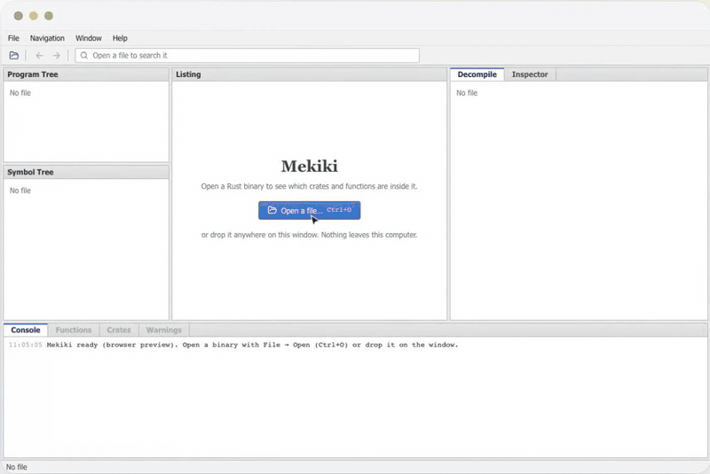

<p align="center">
  
</p>

<h1 align="center">Mekiki</h1>

<p align="center">
  <b>See what is inside a Rust binary.</b><br>
  A free desktop app for macOS, Linux and Windows. Open a Rust program and see its crates, functions and code.
</p>

<p align="center">
  <a href="https://rustsecjp.github.io/mekiki/"><b>Website</b></a> ·
  <a href="https://github.com/RustSecJP/mekiki/releases/latest"><b>Download</b></a> ·
  <a href="README.ja.md">日本語</a>
</p>

<p align="center">
  
</p>

## What it does

Rust programs ship as one big binary with no source. Mekiki opens that file and shows you what went into it:

- **Which crates are inside, and which versions.** Functions are grouped by crate (`serde_json 1.0.x`, `tokio`, the standard library, or "unknown").
- **The code of any function.** Disassembly next to a decompiled view, with panic locations and strings written in as comments.
- **The facts about the file.** Sections, segments, imports, the compiler commit it was built with, and anything odd about its layout.

Mekiki reads Linux ELF and Windows PE files (`.exe` / `.dll`) for x86-64 and x86. Everything runs on your computer; your files are never uploaded.

## Download

| System | File |
| --- | --- |
| macOS (Apple silicon and Intel) | [Mekiki-macos-universal.dmg](https://github.com/RustSecJP/mekiki/releases/latest/download/Mekiki-macos-universal.dmg) |
| Linux (any distribution) | [Mekiki-linux-x86_64.AppImage](https://github.com/RustSecJP/mekiki/releases/latest/download/Mekiki-linux-x86_64.AppImage) |
| Linux (Debian, Ubuntu) | [Mekiki-linux-amd64.deb](https://github.com/RustSecJP/mekiki/releases/latest/download/Mekiki-linux-amd64.deb) |
| Windows (x64) | [Mekiki-windows-x64-setup.exe](https://github.com/RustSecJP/mekiki/releases/latest/download/Mekiki-windows-x64-setup.exe) |

All files and checksums (`SHA256SUMS`) are on the [releases page](https://github.com/RustSecJP/mekiki/releases/latest).

### Install

**macOS.** Open the `.dmg` and drag Mekiki to Applications. The app is not signed with an Apple certificate, so the first time, right-click Mekiki in Applications and choose **Open**, then **Open** again. If macOS says the app "is damaged", run this once in Terminal:

```sh
xattr -dr com.apple.quarantine /Applications/Mekiki.app
```

**Linux (AppImage).** Make the file executable, then run it:

```sh
chmod +x Mekiki-linux-x86_64.AppImage
./Mekiki-linux-x86_64.AppImage
```

**Linux (.deb).** `sudo apt install ./Mekiki-linux-amd64.deb`, then start Mekiki from your app menu.

**Windows.** Run the installer. SmartScreen may warn that the publisher is unknown; choose **More info**, then **Run anyway**.

Then open a file with **File → Open** (`Ctrl+O`) or drop it on the window. New to this? **Help → Tutorial** walks you through Mekiki using its own executable as the practice file.

## When you'll use it

- **A strange binary turned up on a server.** Before you run it, open it in Mekiki: what crates does it use (networking? crypto? process control?), what strings and panic messages does it carry, what does `main` do?
- **Checking what a binary really ships.** Your SBOM says one thing; the release binary may say another. See every crate and version compiled in, and which compiler commit built it, from the binary alone.
- **Analyzing Rust malware.** Rust malware is hard to read in general tools: names are long and mangled, and the standard library buries the interesting code. Mekiki separates the author's code from crates and `std`, and can name functions in stripped files with fingerprint databases.
- **Learning how Rust compiles.** Write a small program, build it, and look at what `Option`, iterators or `?` turn into, function by function.

## Features

- **Symbol Tree** groups functions into your program, each crate (with version), the standard library, and unknown.
- **Listing** shows the code in address order, with disassembly, function headers and clickable references. Back and forward like a browser (`Alt+←` / `Alt+→`).
- **Decompile** turns a function into readable code, written Rust-style or C-style, with panic locations and string contents noted beside it. It uses Ghidra's decompiler, built in. No Java and no Ghidra install needed.
- **Inspector** shows details for what you select; crates link to crates.io and docs.rs.
- **Tables** for Functions, Crates and Warnings, sortable and filterable.
- **Go to anything** with `G`: an address, a function, a section or a crate.
- **Fingerprints** name functions in stripped binaries. Load fingerprint databases, or add a file you trust to your own.
- **Windows files too:** imports appear by name in the code (`kernel32.dll!CreateFileW`).

## Everything runs locally

Mekiki never sends your files anywhere, and it does not phone home. It reads the file and never runs it. The decompiler runs in a separate process, so a file that confuses it cannot take down the app.

## How it works

Mekiki is built on **unforge**, a set of Rust libraries in this repository that read ELF and PE files without panicking, even when the file is broken or made hostile on purpose. unforge finds the functions, works out which crate each one belongs to from the paths and symbols the compiler leaves behind, and disassembles them with iced-x86. The decompile view comes from Ghidra's C++ decompiler, built into a small helper program that Mekiki starts as needed. The window is a Tauri app.

## FAQ

**Does it run the binary?** No. It only reads the bytes.

**Which files can it open?** Linux ELF and Windows PE, for x86-64 and x86. Rust binaries get the most out of it (crates, versions, panic notes). Other programs open too, with less detail.

**Is it free?** Yes. Open source under MIT or Apache-2.0.

**Why is the macOS app unsigned?** Signing needs a paid Apple account. The build runs on GitHub Actions from this repository; you can check the files against `SHA256SUMS` or build Mekiki yourself.

---

## For developers

- **Build from source and component details:** [DEVELOPMENT.md](DEVELOPMENT.md)
- **The unforge libraries and the `unforge` command-line tool** (Japanese): [docs/unforge.ja.md](docs/unforge.ja.md)
- **The decompiler helper:** [mekiki/decompiler/README.md](mekiki/decompiler/README.md)

## License

MIT or Apache-2.0, at your option ([LICENSE-MIT](LICENSE-MIT), [LICENSE-APACHE](LICENSE-APACHE)). The decompiler in `mekiki/decompiler/ghidra/` and the processor files in `mekiki/decompiler/specs/` come from [Ghidra](https://github.com/NationalSecurityAgency/ghidra) and are under Apache-2.0 ([LICENSE](mekiki/decompiler/LICENSE-APACHE-2.0), [NOTICE](mekiki/decompiler/NOTICE)).

RustSecJP is an unofficial community, not affiliated with the Rust Project or Rust Foundation.

Made by [kura](https://hina-kura49.github.io/portfolio/) · [GitHub](https://github.com/hina-kura49) · [X](https://x.com/hkurashina49) · [Instagram](https://www.instagram.com/hina_kura49/) · [Facebook](https://www.facebook.com/profile.php?id=61597175063829) · [RustSecJP](https://github.com/RustSecJP)
